# Multi-Tenant SaaS: Helpdesk

**English** · [Türkçe](README.tr.md)

A support ticket system that many companies share, each in its own walled garden. A company signs up, gets a public support form at its own address and a panel for its team; its tickets, notes, files and audit log are invisible to every other company on the same database. Isolation is enforced twice: every query is filtered by the organization in the application, and PostgreSQL row-level security refuses other organizations' rows even when a query forgets to filter. Plans (Free, Team, Business) cap seats, tickets per month, file storage and requests per minute, with limits that hold when requests race.

[](https://github.com/Beratoguzhan620/multi-tenant-saas/actions/workflows/ci.yml)


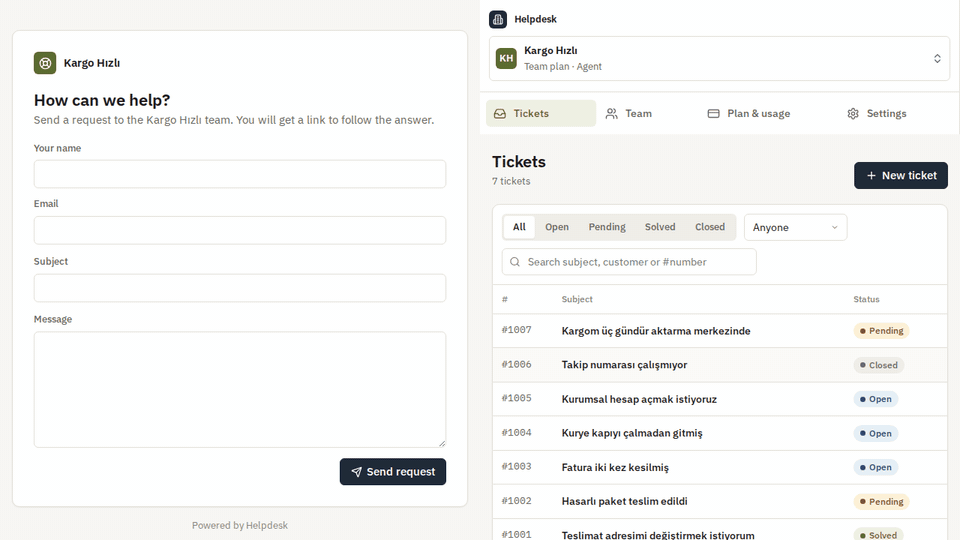

## Try it

```bash
docker compose up --build
```

This starts PostgreSQL, the API and nginx, which serves the panel and forwards the API. Open http://localhost:8080, create an organization, then open its support form at http://localhost:8080/support/&lt;your-address&gt; in a private window and send yourself a request.

- API reference: http://localhost:8080/scalar
- Invite a teammate from *Team*; the link opens a join page.
- Create a second organization from the switcher at the top left: it starts empty.

## Features

- **Organizations:** signing up creates an organization and makes you its owner. One person can belong to several organizations and switch between them; the access token carries the active one, and membership and role are checked against the database on every request, so someone removed loses access at once.
- **Roles:** Owner (plan, ownership), Admin (team, settings, audit log) and Agent (tickets). Admins manage agents; only the owner promotes admins or hands the organization over.
- **Invitations:** an admin invites an email address with a role and gets a link to send on. It works once, for that address, for 7 days; only its hash is stored. The invitee joins with a new account or accepts while signed in.
- **Tickets:** numbered per organization from #1001, so every company has its own #1001. Status (Open, Pending, Solved, Closed), priority, assignee, search by subject, customer or number, filters and paging. A reply from the team moves a ticket to Pending, the customer's answer back to Open; a closed ticket stays closed.
- **Internal notes:** notes only the team sees, never sent to the customer's page.
- **Public support form:** each organization's form at `/support/<address>`. Customers need no account; they get a private link (its key in the URL fragment, only a hash stored) to follow the request and reply.
- **Files:** attachments up to 10 MB of safe types, downloaded as files and never rendered inline, counted against the plan's storage.
- **Plans and limits:** seats (members and open invitations), tickets per month, storage and requests per minute per organization. Upgrades apply at once; a downgrade is refused with the reasons while more seats or storage are in use than the smaller plan has.
- **Audit log:** who invited, removed or promoted whom, plan changes, renames, assignments, status changes and deleted files. The application can add to it but not change or delete it.
- **Admin panel:** React and TypeScript. Ticket inbox, ticket page with conversation, notes and files, team and invitations, plan and usage meters, audit log, settings, an organization switcher, empty, loading and error states, and a phone layout.

## Screenshots

| Ticket inbox | A ticket with an internal note |
|---|---|
| 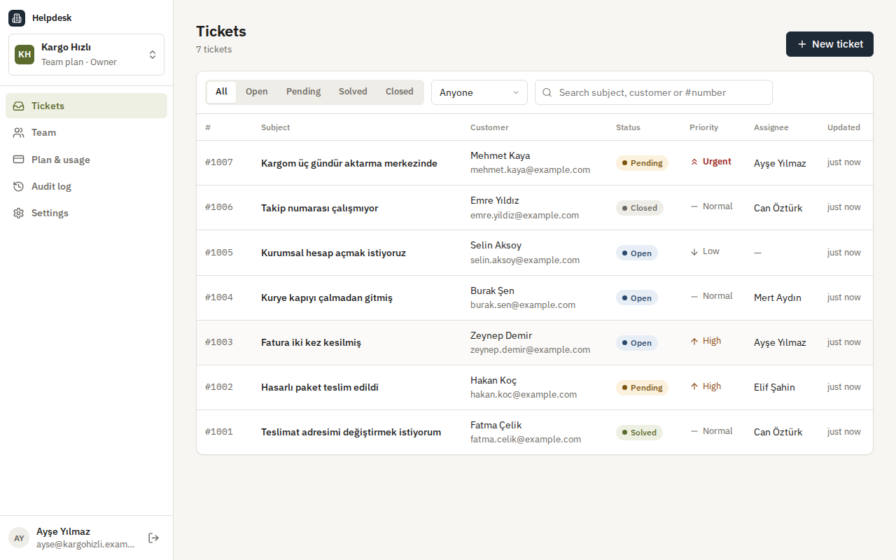 | 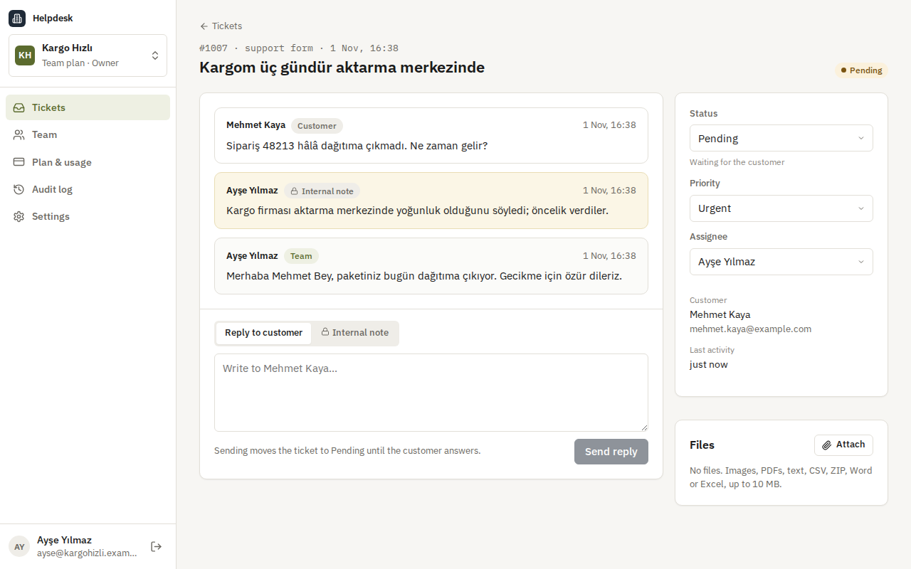 |
| **The public support form** | **The customer's page** |
| 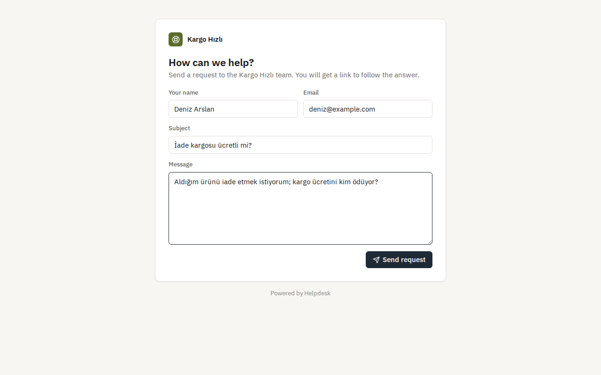 | 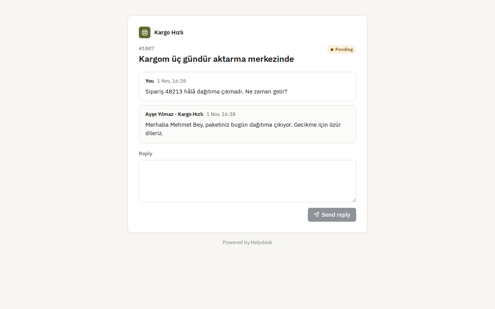 |
| **Team and invitations** | **Plan and usage** |
| 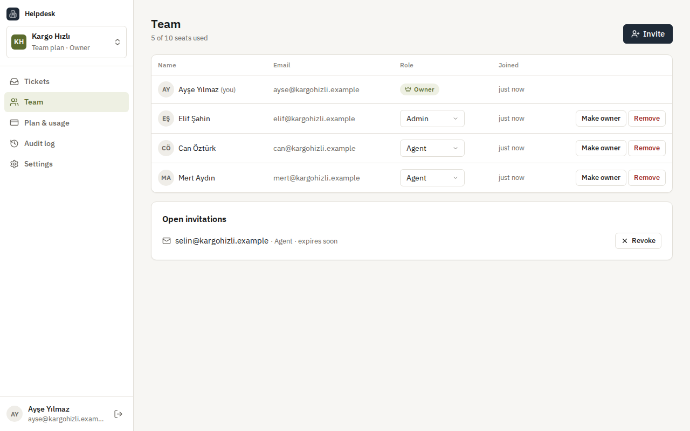 | 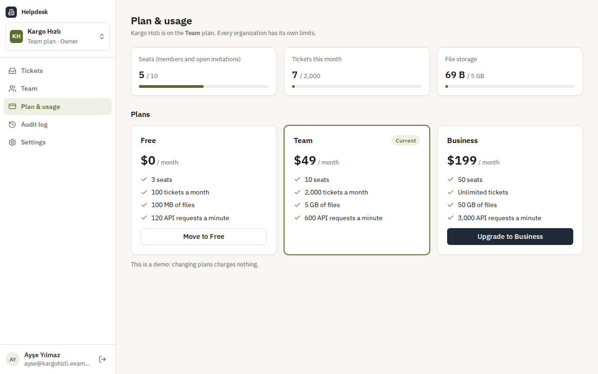 |
| **Audit log** | **Switching organization** |
| 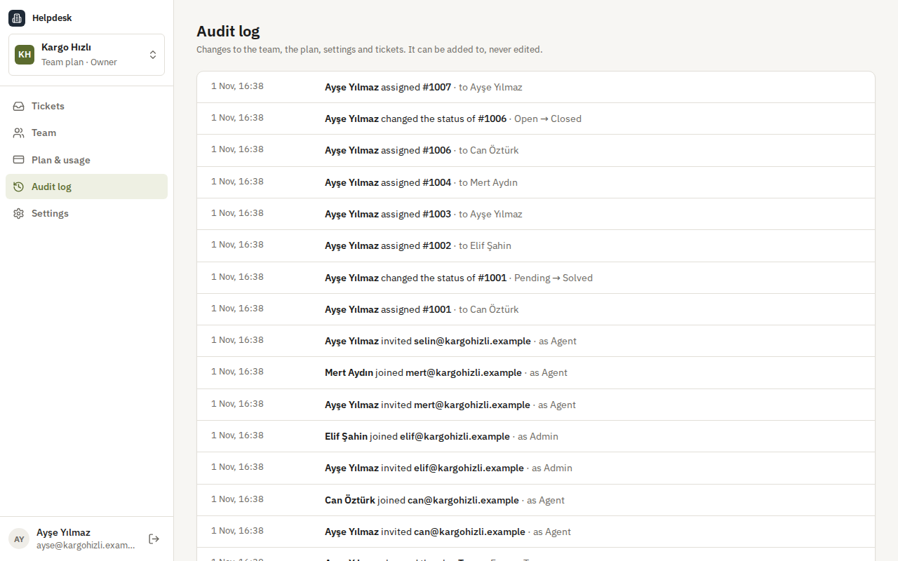 | 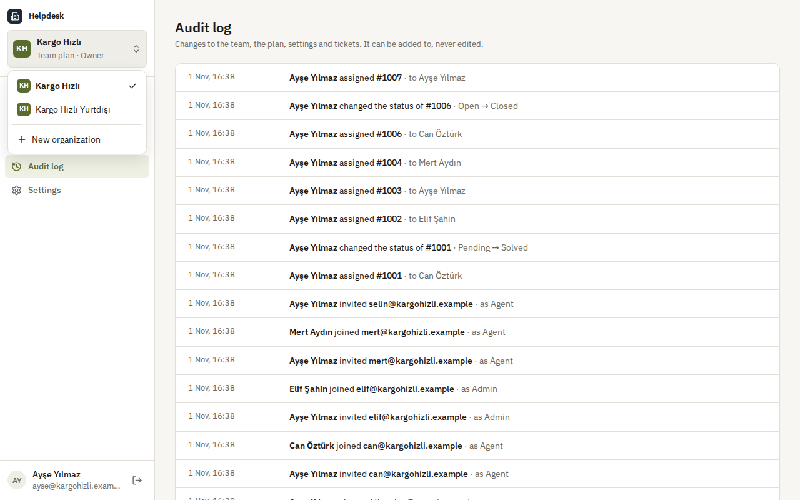 |
| **On a phone** | **API reference** |
| 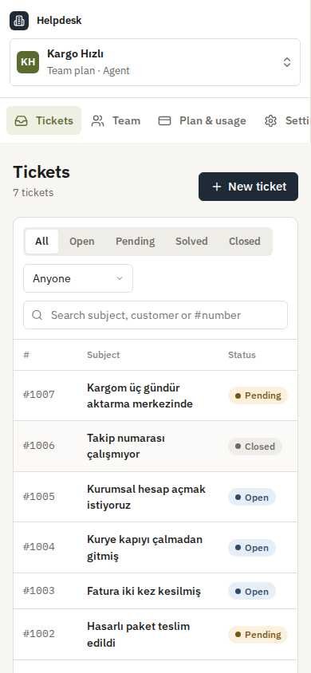 | 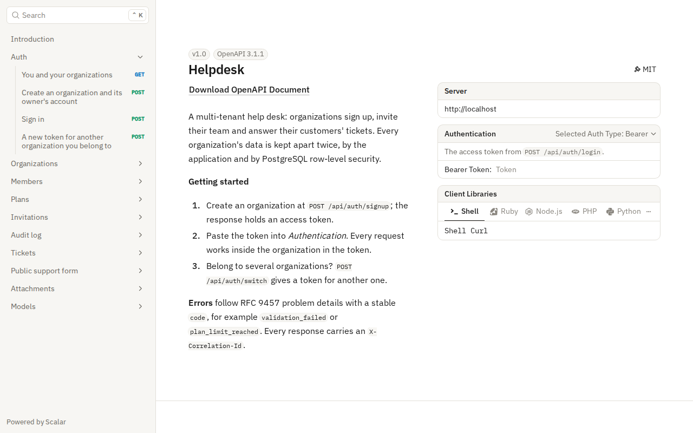 |

## Isolation under load

Measured in CI on a standard GitHub runner by `tests/load/tenants.mjs`, against the Compose stack (nginx, API, PostgreSQL) on the same machine as the load client. 50 organizations each open 40 tickets at the same time, half by the team and half through the public form, 32 requests in flight; then every organization lists its tickets and reads #1001 and its newest ticket.

| Measure | Result |
|---|---|
| Tickets created | 2,000 in 4.2 s (482 per second), none failed |
| Create a ticket (limit check, number, ticket and first message in one transaction) | p50 57 ms · p95 97 ms · p99 233 ms |
| List an organization's tickets | p50 69 ms · p95 78 ms · p99 79 ms |
| Read one ticket | p50 31 ms · p95 40 ms · p99 47 ms |
| Isolation | every organization saw exactly its own 40 tickets, numbered #1001 to #1040, and found none of another's |

## Tech stack

- ASP.NET Core 10: minimal APIs, ProblemDetails, OpenAPI with Scalar, JWT bearer authentication with policy-based authorization, rate limiting partitioned by organization
- PostgreSQL 17 with Entity Framework Core 10 (Npgsql): global query filters, row-level security policies, a separate database role for the application, migrations
- React 18, TypeScript and Vite; Lucide icons and IBM Plex
- nginx serving the panel and forwarding the API, with a strict content security policy
- xUnit, Testcontainers (real PostgreSQL), Vitest, Playwright
- GitHub Actions: warnings as errors, .NET and web tests, pending-migration check, Compose smoke test, the browser walkthrough
- Docker / Docker Compose

## Architecture

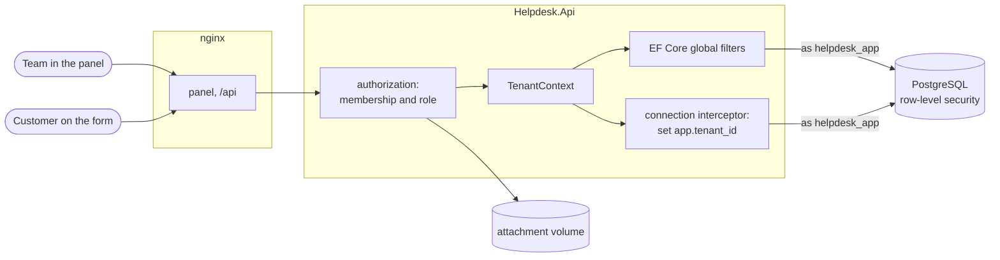

One request, two locks on the door:

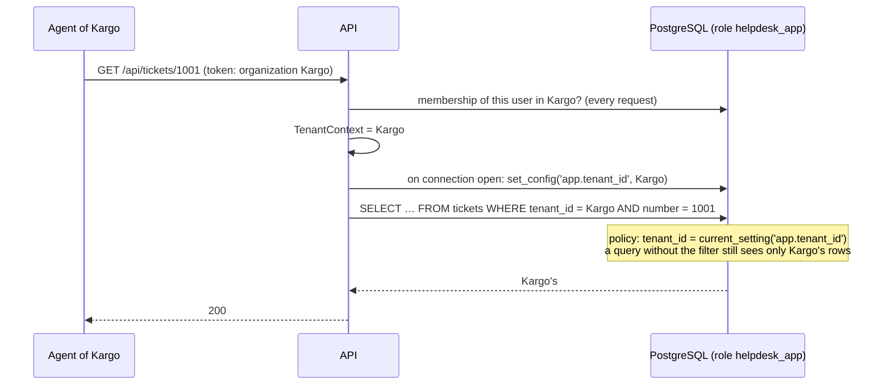

## Design decisions

- **Shared tables, two layers of isolation.** All organizations share one schema; every tenant table has a `tenant_id`. The application filters every query through EF Core global query filters, and PostgreSQL enforces the same rule with row-level security, so a forgotten filter, a raw SQL query or `IgnoreQueryFilters()` still cannot cross the line. One schema keeps migrations, indexes and connection pools simple for thousands of small organizations.
- **The application cannot switch the guard off.** The API connects as `helpdesk_app`: it owns no table, is not a superuser and has no `BYPASSRLS`, so the policies apply to it and it cannot disable them. Migrations run as the owner through a separate connection string. Tests connect as `helpdesk_app` directly and check that it sees nothing without an organization, only one organization's rows with one, and that inserting into another organization fails.
- **The organization travels with the connection.** A connection interceptor runs `set_config('app.tenant_id', …)` every time EF Core opens a connection, from the request's `TenantContext`, and sets it to empty when there is none, which matches no rows. Pooled connections therefore never keep the previous request's organization; a test checks exactly that.
- **The token names the organization, the database decides.** The JWT carries the active organization, but the membership and role are read on every request. Removing someone or demoting them takes effect on their next click, not when their token expires.
- **Numbers per organization, without gaps.** The next ticket number comes from `UPDATE tenants SET last_ticket_number = last_ticket_number + 1 … RETURNING` inside the transaction that stores the ticket. Concurrent tickets queue on the row, and a failed insert gives its number back.
- **Limits that hold when requests race.** Monthly tickets and storage are counters in `usage_counters`, changed by one conditional `INSERT … ON CONFLICT DO UPDATE … WHERE value + n <= limit`: the check and the increment are the same statement. Inside the transaction a rollback gives the amount back. Seats lock the organization row before counting. Tests fire requests in parallel at a counter near its limit and check that exactly the allowed number get through.
- **Downgrades never delete.** Moving to a smaller plan is refused, with the reasons, while the organization uses more seats or storage than that plan has; the owner decides what to remove.
- **Per-organization rate limits.** Every organization gets its own budget of requests per minute by plan, shared by its members, so one busy organization cannot slow down the others. The plan is cached for 30 seconds and dropped when it changes.
- **Secrets as hashes, links as fragments.** Invitation links and customers' ticket keys are random 256-bit values; only their SHA-256 is stored. The panel puts them after `#`, which browsers never send to a server, and nginx sends `Referrer-Policy: no-referrer`. An invitation token starts with its organization's id, so it is looked up under that organization's isolation like every other row.
- **"Not found", never "forbidden", across organizations.** Another organization's ticket, file or invitation does not exist as far as the caller can tell; a customer's wrong key looks the same as a missing ticket.
- **An append-only audit log.** Events are written in the transaction of the change they describe, and `helpdesk_app` has no `UPDATE` or `DELETE` on `audit_events`.
- **Files are data, not pages.** Attachments are stored under keys made of ids, never of file names; only safe types are accepted; downloads always come as attachments with `nosniff`.

## Commands

| Command | What it does |
|---|---|
| `docker compose up --build` | PostgreSQL, the API and nginx with the panel on http://localhost:8080 |
| `dotnet test` | .NET unit and integration tests (Docker needed for Testcontainers) |
| `cd web && npm install && npm test` | Panel unit tests |
| `cd web && npm run dev` | The panel with hot reload on http://localhost:5173, against an API on port 8080 |
| `cd tests/e2e && npm install && node helpdesk.mjs` | The browser walkthrough against a running stack started with `AUTH_ATTEMPTS_PER_MINUTE=1000` |
| `node tests/load/tenants.mjs 50 40 32` | The many-organization test against a running stack started with `AUTH_ATTEMPTS_PER_MINUTE=100000 PUBLIC_REQUESTS_PER_MINUTE=100000` |
| `dotnet ef migrations add <Name> --project src/Helpdesk.Infrastructure --startup-project src/Helpdesk.Api --output-dir Persistence/Migrations` | Add a migration |

Configuration for a local run, kept out of the repository:

```bash
dotnet user-secrets --project src/Helpdesk.Api set "ConnectionStrings:Helpdesk" "Host=localhost;Database=helpdesk;Username=helpdesk_app;Password=…"
dotnet user-secrets --project src/Helpdesk.Api set "ConnectionStrings:Migrations" "Host=localhost;Database=helpdesk;Username=<owner>;Password=…"
dotnet user-secrets --project src/Helpdesk.Api set "Jwt:SigningKey" "<at least 32 characters>"
```

The `helpdesk_app` role needs a password and `LOGIN` (`deploy/postgres/10-app-role.sh` does it in Compose); the migrations give it access to the tables.

## Tests

118 tests and a browser walkthrough: 55 .NET unit tests, 56 integration tests that run the real API against PostgreSQL in Testcontainers, connecting as the same restricted role as production, 7 Vitest tests for the panel, and a 14-step Playwright walkthrough against the Compose stack in CI.

- **Isolation through the API:** two organizations both have a #1001 and each sees its own; another organization's ticket, comments, files and invitations are not found; tickets cannot be assigned to someone from another organization; a customer key only works on its own organization's form; a forged invitation token pointing at another organization finds nothing.
- **Isolation in the database:** as `helpdesk_app`, no rows without an organization; only one organization's rows with one, even with no `WHERE`; updates and deletes of other organizations' rows change nothing; inserting into another organization is refused; the role cannot bypass or disable row-level security; `IgnoreQueryFilters()` still returns one organization; a pooled connection does not keep the previous organization; the audit log cannot be deleted.
- **Tickets:** numbering from 1001 per organization, 20 concurrent tickets without gaps or repeats, status changes on replies and notes, closed tickets, filters, search and paging, validation.
- **Customers:** opening, following and answering a ticket with the key; internal notes never shown; a wrong key looks like a missing ticket.
- **Plans and limits:** three seats on Free, open invitations included; six parallel invitations take exactly the two free seats; ten parallel tickets at 95 of 100 let exactly five through, with numbers 1001 to 1005; storage near its limit refuses a file that does not fit; downgrades refused with reasons, then allowed; the per-organization request budget, and another organization unaffected.
- **Team:** joining with a new account or an existing one, wrong address, revoked links, role rules, removal taking effect on the next request, leaving, handing over ownership, the audit log and its paging.
- **Files:** upload, download headers, delete and the storage counter, unsafe types refused, file names cleaned, only the uploader or an admin deletes.
- **Panel (Vitest):** routes and secrets in the fragment, query strings, sizes and dates, Turkish slugs.
- **Browsers (CI):** sign-up, a customer's request, a note and a reply, the customer seeing the reply and not the note, a file, an invitation accepted in another browser, a second organization seeing none of it even by number, an upgrade, the audit log, switching organizations, the phone layout and no script errors.

## Roadmap and known gaps

- Billing through a payment provider; plan changes are free here.
- Email: invitations and customer replies are links to send on by hand today; the [notification-service](https://github.com/Beratoguzhan620/notification-service) could send them.
- Customers cannot attach files on the public form yet.
- Object storage for attachments; the local volume suits a single server.
- The per-organization rate limit lives in each API instance; with several instances it would move to Redis.
- Custom domains and branding for the support form.

## License

[MIT](LICENSE) · Berat Oğuzhan Turğut · [GitHub](https://github.com/Beratoguzhan620)
