# Multi-Tenant SaaS: Helpdesk

[English](README.md) · **Türkçe**

Birçok şirketin ortak kullandığı, ama her birinin kendi duvarları içinde kaldığı bir destek talebi sistemi. Bir şirket kaydolur; kendi adresinde herkese açık bir destek formu ve ekibi için bir yönetim paneli alır. Talepleri, notları, dosyaları ve denetim kaydı, aynı veritabanını kullanan diğer şirketlere görünmez. Yalıtım iki katmanda sağlanır: uygulama her sorguyu organizasyona göre süzer, PostgreSQL'in satır düzeyi güvenliği (row-level security) de bir sorgu süzmeyi unutsa bile başka organizasyonların satırlarını vermez. Planlar (Free, Team, Business) kullanıcı sayısını, aylık talep sayısını, dosya alanını ve dakikalık istek sayısını sınırlar; istekler aynı anda gelse bile sınırlar aşılmaz.

[](https://github.com/Beratoguzhan620/multi-tenant-saas/actions/workflows/ci.yml)


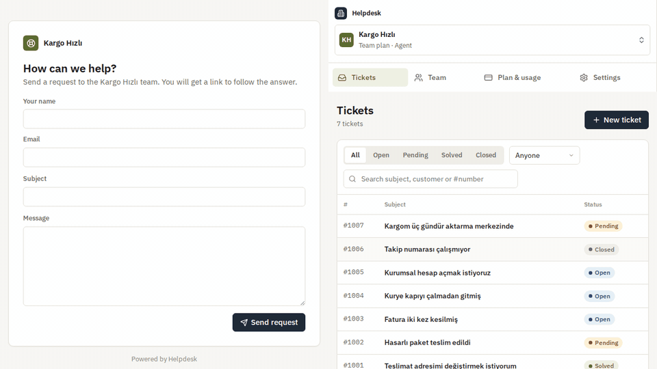

## Deneyin

```bash
docker compose up --build
```

PostgreSQL, API ve paneli sunup API'ye yönlendiren nginx başlar. http://localhost:8080 adresini açın, bir organizasyon oluşturun; ardından gizli bir pencerede http://localhost:8080/support/&lt;adresiniz&gt; destek formunu açıp kendinize bir talep gönderin.

- API dokümantasyonu: http://localhost:8080/scalar
- *Team* sayfasından bir ekip arkadaşınızı davet edin; bağlantı katılma sayfasını açar.
- Sol üstteki seçiciden ikinci bir organizasyon oluşturun: boş başlar.

## Özellikler

- **Organizasyonlar:** kaydolmak bir organizasyon oluşturur ve sizi sahibi yapar. Bir kişi birden çok organizasyona üye olup aralarında geçiş yapabilir; erişim belirteci (token) etkin organizasyonu taşır, üyelik ve rol her istekte veritabanından kontrol edilir. Böylece çıkarılan biri erişimini hemen kaybeder.
- **Roller:** Owner (plan, sahiplik), Admin (ekip, ayarlar, denetim kaydı) ve Agent (talepler). Admin'ler agent'ları yönetir; admin atamayı ve organizasyonu devretmeyi yalnızca sahip yapar.
- **Davetler:** admin bir e-posta adresini bir rolle davet eder ve iletilecek bir bağlantı alır. Bağlantı bir kez, yalnızca o adres için, 7 gün geçerlidir; yalnızca özeti (hash) saklanır. Davet edilen kişi yeni hesapla katılır ya da oturum açıkken kabul eder.
- **Talepler:** her organizasyonda #1001'den başlayarak numaralanır, yani her şirketin kendi #1001'i vardır. Durum (Open, Pending, Solved, Closed), öncelik, atanan kişi; konu, müşteri ya da numarayla arama, filtreler ve sayfalama. Ekibin yanıtı talebi Pending'e, müşterinin yanıtı yeniden Open'a alır; kapanan talep kapalı kalır.
- **İç notlar:** yalnızca ekibin gördüğü notlar; müşterinin sayfasına asla gitmez.
- **Herkese açık destek formu:** her organizasyonun formu `/support/<adres>` adresindedir. Müşterinin hesaba ihtiyacı yoktur; talebini izleyip yanıtlayabileceği özel bir bağlantı alır (anahtar URL'nin `#` sonrasında, sunucuda yalnızca özeti).
- **Dosyalar:** güvenli türlerde 10 MB'a kadar ekler; her zaman dosya olarak indirilir, sayfada açılmaz; planın depolama alanından düşülür.
- **Planlar ve sınırlar:** organizasyon başına koltuk (üyeler ve açık davetler), aylık talep, depolama ve dakikalık istek. Yükseltme hemen geçerli olur; daha küçük plana geçiş, o planın izin verdiğinden fazla koltuk ya da alan kullanıldığı sürece nedenleriyle reddedilir.
- **Denetim kaydı:** kim kimi davet etti, çıkardı ya da yetkilendirdi; plan değişiklikleri, ad değişiklikleri, atamalar, durum değişiklikleri ve silinen dosyalar. Uygulama kayda ekleme yapabilir ama değiştiremez, silemez.
- **Yönetim paneli:** React ve TypeScript. Talep kutusu; konuşma, not ve dosyalarıyla talep sayfası; ekip ve davetler; plan ve kullanım göstergeleri; denetim kaydı; ayarlar; organizasyon seçici; boş, yükleniyor ve hata durumları; telefon görünümü.

## Ekran görüntüleri

| Talep kutusu | İç notlu bir talep |
|---|---|
| 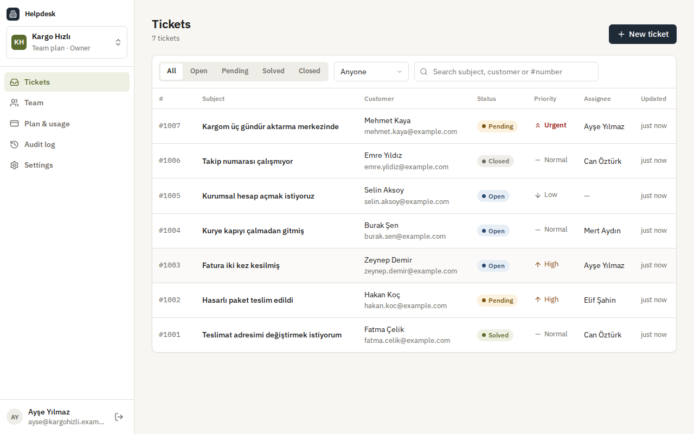 | 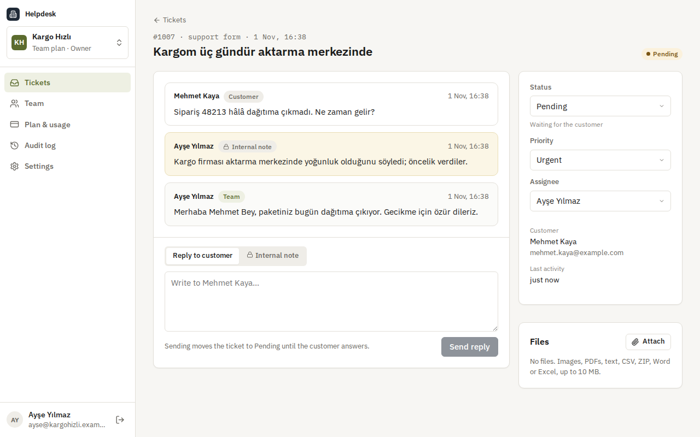 |
| **Herkese açık destek formu** | **Müşterinin sayfası** |
| 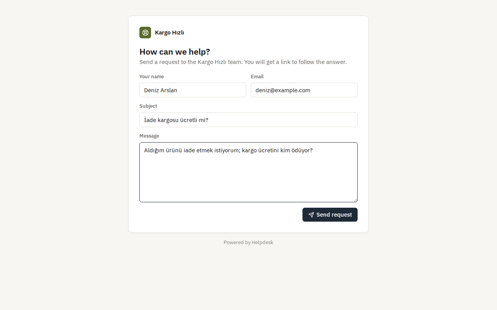 | 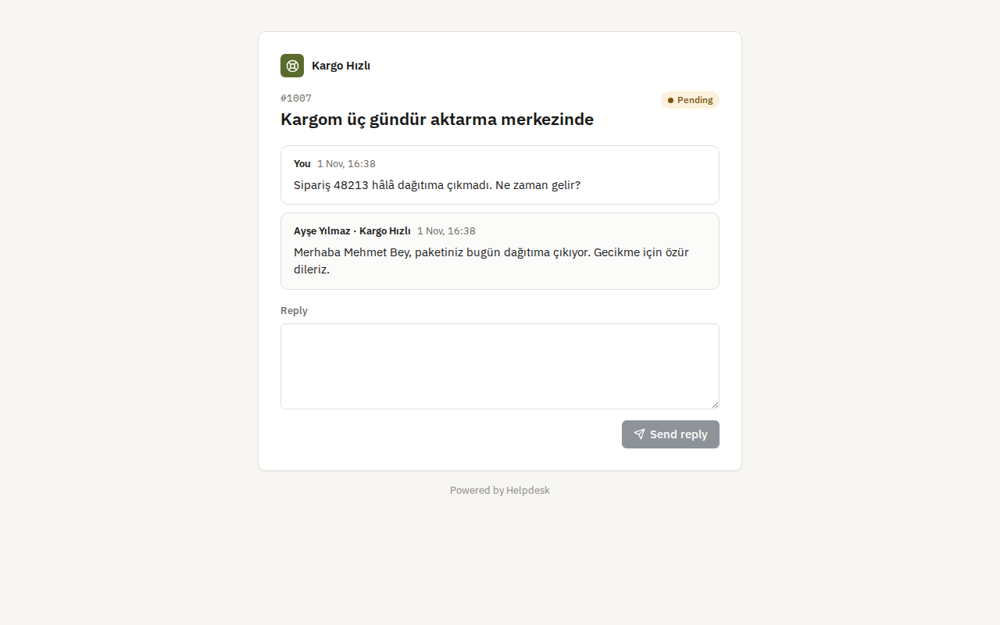 |
| **Ekip ve davetler** | **Plan ve kullanım** |
| 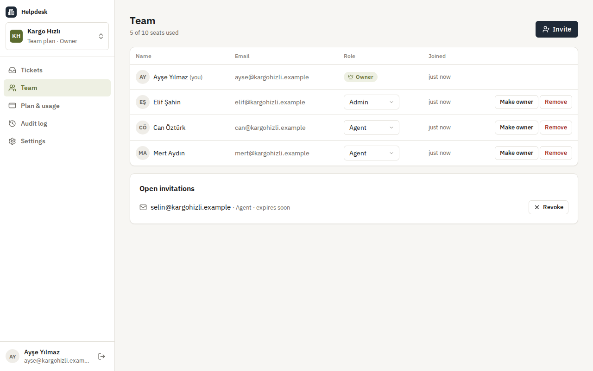 | 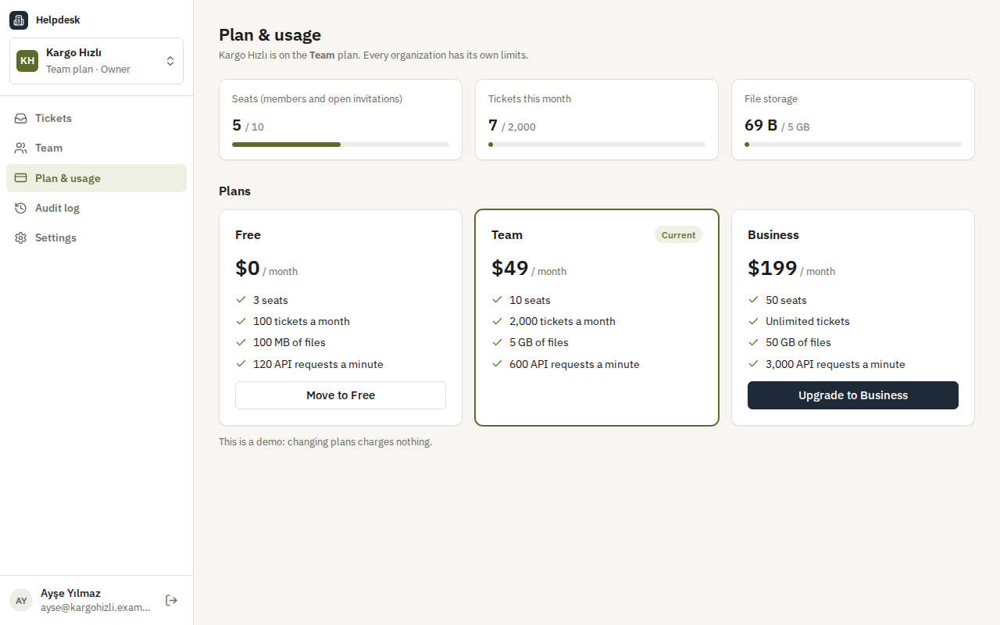 |
| **Denetim kaydı** | **Organizasyon değiştirme** |
| 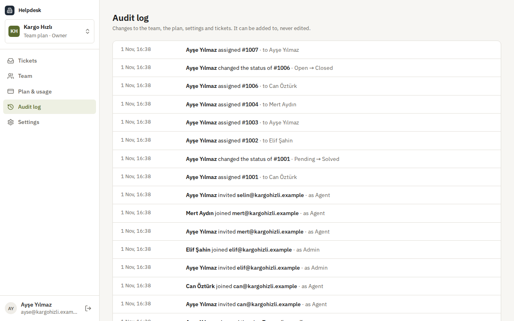 | 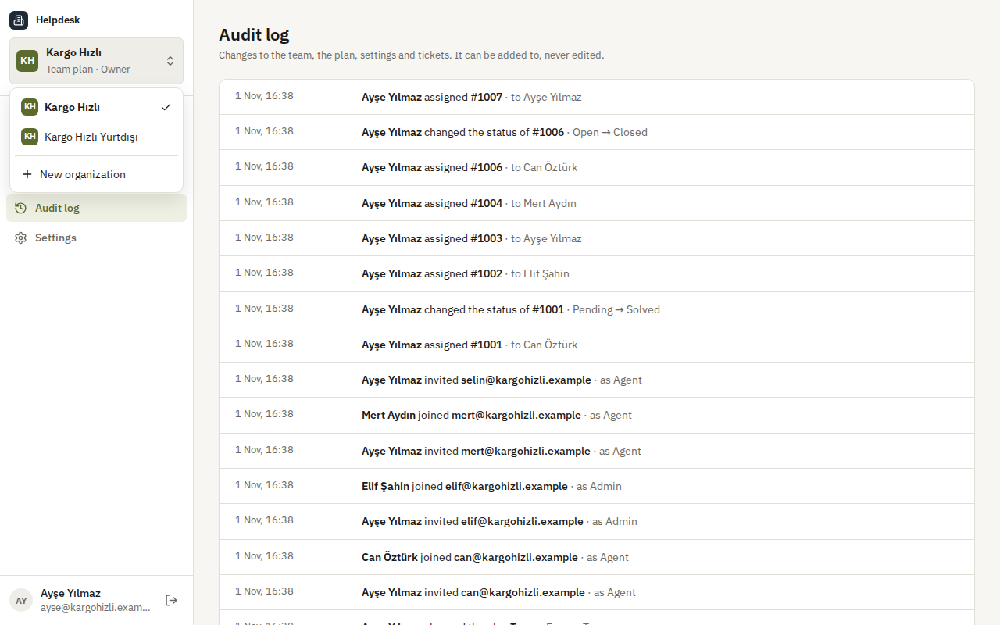 |
| **Telefonda** | **API dokümantasyonu** |
| 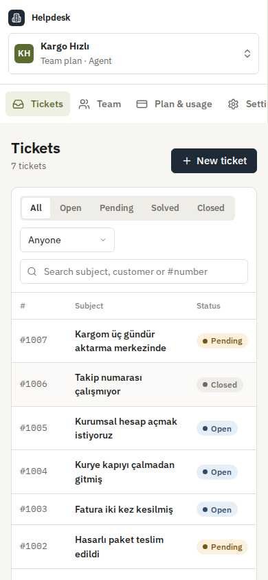 | 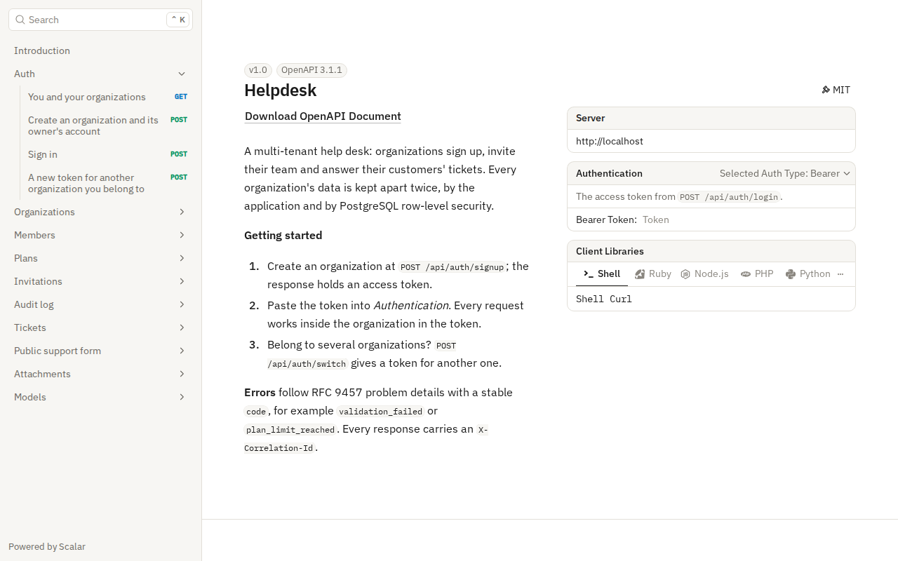 |

## Yük altında yalıtım

CI'da standart bir GitHub sunucusunda `tests/load/tenants.mjs` ile, yük istemcisiyle aynı makinedeki Compose yığınına (nginx, API, PostgreSQL) karşı ölçüldü. 50 organizasyonun her biri aynı anda 40 talep açar (yarısı ekipten, yarısı herkese açık formdan), aynı anda 32 istek; ardından her organizasyon taleplerini listeler, #1001'i ve en yeni talebini okur.

| Ölçüm | Sonuç |
|---|---|
| Açılan talep | 4.2 saniyede 2.000 (saniyede 482), hiçbiri başarısız değil |
| Talep açma (sınır kontrolü, numara, talep ve ilk mesaj tek işlemde) | p50 57 ms · p95 97 ms · p99 233 ms |
| Bir organizasyonun taleplerini listeleme | p50 69 ms · p95 78 ms · p99 79 ms |
| Tek talep okuma | p50 31 ms · p95 40 ms · p99 47 ms |
| Yalıtım | her organizasyon tam olarak kendi 40 talebini, #1001'den #1040'e numaralı gördü; başkasınınkini hiç bulamadı |

## Teknolojiler

- ASP.NET Core 10: minimal API'ler, ProblemDetails, Scalar ile OpenAPI, politika tabanlı yetkilendirmeli JWT kimlik doğrulama, organizasyona göre bölümlenmiş istek sınırı
- PostgreSQL 17 ve Entity Framework Core 10 (Npgsql): global sorgu filtreleri, satır düzeyi güvenlik politikaları, uygulamaya ayrı veritabanı rolü, migration'lar
- React 18, TypeScript ve Vite; Lucide ikonları ve IBM Plex
- Paneli sunan ve API'ye yönlendiren, katı içerik güvenliği politikası gönderen nginx
- xUnit, Testcontainers (gerçek PostgreSQL), Vitest, Playwright
- GitHub Actions: uyarılar hata sayılır, .NET ve web testleri, bekleyen migration kontrolü, Compose duman testi, tarayıcı senaryosu
- Docker / Docker Compose

## Mimari

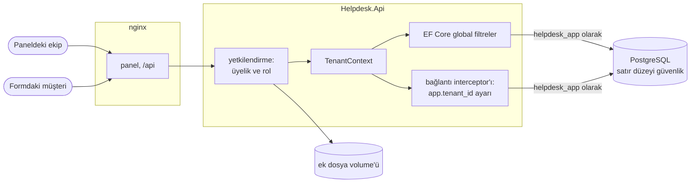

Bir istek, kapıda iki kilit:

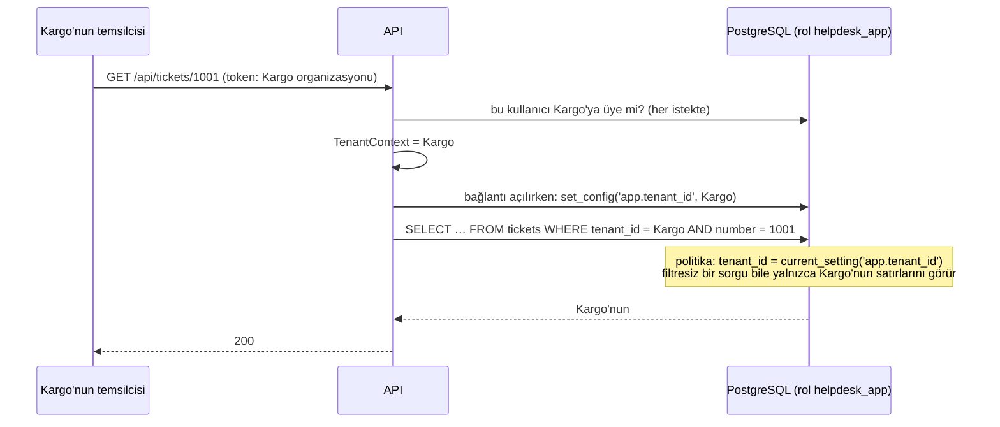

## Tasarım kararları

- **Ortak tablolar, iki katmanlı yalıtım.** Tüm organizasyonlar tek şemayı paylaşır; her kiracı tablosunda `tenant_id` vardır. Uygulama her sorguyu EF Core global sorgu filtreleriyle süzer, PostgreSQL de aynı kuralı satır düzeyi güvenlikle uygular. Unutulan bir filtre, ham bir SQL sorgusu ya da `IgnoreQueryFilters()` bile sınırı aşamaz. Tek şema, binlerce küçük organizasyon için migration'ları, indeksleri ve bağlantı havuzlarını basit tutar.
- **Uygulama bekçiyi kapatamaz.** API `helpdesk_app` olarak bağlanır: hiçbir tablonun sahibi değildir, süper kullanıcı değildir, `BYPASSRLS` yetkisi yoktur; politikalar ona uygulanır ve onları kapatamaz. Migration'lar ayrı bir bağlantı dizesiyle sahip rolüyle çalışır. Testler doğrudan `helpdesk_app` olarak bağlanıp organizasyon yokken hiçbir şey görmediğini, bir organizasyonla yalnızca onun satırlarını gördüğünü ve başka organizasyona satır ekleyemediğini doğrular.
- **Organizasyon bağlantıyla birlikte gider.** Bir bağlantı interceptor'ı, EF Core her bağlantı açtığında isteğin `TenantContext`'inden `set_config('app.tenant_id', …)` çalıştırır; organizasyon yoksa boş değer verir, bu da hiçbir satırla eşleşmez. Böylece havuzdaki bağlantılar önceki isteğin organizasyonunu taşımaz; bir test tam olarak bunu kontrol eder.
- **Token organizasyonu söyler, karar veritabanınındır.** JWT etkin organizasyonu taşır ama üyelik ve rol her istekte okunur. Birini çıkarmak ya da rolünü düşürmek, token'ının süresi dolunca değil, bir sonraki tıklamasında etkili olur.
- **Organizasyona özel, boşluksuz numaralar.** Sıradaki talep numarası, talebi kaydeden işlemin içinde `UPDATE tenants SET last_ticket_number = last_ticket_number + 1 … RETURNING` ile alınır. Aynı anda açılan talepler satır kilidinde sıraya girer; başarısız bir kayıt numarasını geri verir.
- **İstekler yarışınca da tutan sınırlar.** Aylık talep ve depolama `usage_counters` tablosunda sayaçtır ve tek bir koşullu `INSERT … ON CONFLICT DO UPDATE … WHERE value + n <= limit` ile değişir: kontrol ve artırma aynı komuttur. İşlem geri alınırsa miktar da geri gelir. Koltuklar, saymadan önce organizasyon satırını kilitler. Testler, sınırına yakın bir sayaca paralel istekler gönderip tam izin verilen sayının geçtiğini doğrular.
- **Plan düşürmek hiçbir şey silmez.** Daha küçük plana geçiş, o planın izin verdiğinden fazla koltuk ya da alan kullanıldığı sürece nedenleriyle reddedilir; neyin kaldırılacağına sahip karar verir.
- **Organizasyon başına istek sınırı.** Her organizasyonun, planına göre, üyelerinin paylaştığı kendi dakikalık istek bütçesi vardır; yoğun bir organizasyon diğerlerini yavaşlatamaz. Plan 30 saniye önbellekte tutulur ve değişince hemen silinir.
- **Sırlar özet olarak, bağlantılar `#` ile.** Davet bağlantıları ve müşterilerin talep anahtarları 256 bitlik rastgele değerlerdir; yalnızca SHA-256 özetleri saklanır. Panel bunları tarayıcıların sunucuya hiç göndermediği `#` sonrasına koyar, nginx de `Referrer-Policy: no-referrer` gönderir. Davet token'ı organizasyonun kimliğiyle başlar; böylece diğer her satır gibi o organizasyonun yalıtımı altında aranır.
- **Organizasyonlar arasında "yok", asla "yasak" değil.** Başka bir organizasyonun talebi, dosyası ya da daveti, soran için yoktur; müşterinin yanlış anahtarı da var olmayan bir talep gibi görünür.
- **Yalnızca eklenebilen denetim kaydı.** Olaylar, anlattıkları değişikliğin işleminde yazılır; `helpdesk_app` rolünün `audit_events` üzerinde `UPDATE` ya da `DELETE` yetkisi yoktur.
- **Dosyalar sayfa değil, veridir.** Ekler dosya adından değil, kimliklerden oluşan anahtarlarla saklanır; yalnızca güvenli türler kabul edilir; indirmeler her zaman `nosniff` ile ek olarak gelir.

## Komutlar

| Komut | Ne yapar |
|---|---|
| `docker compose up --build` | PostgreSQL, API ve paneli http://localhost:8080 adresinde sunan nginx |
| `dotnet test` | .NET birim ve entegrasyon testleri (Testcontainers için Docker gerekir) |
| `cd web && npm install && npm test` | Panel birim testleri |
| `cd web && npm run dev` | 8080 portundaki API'ye bağlı, anında yenilenen panel: http://localhost:5173 |
| `cd tests/e2e && npm install && node helpdesk.mjs` | `AUTH_ATTEMPTS_PER_MINUTE=1000` ile başlatılmış yığına karşı tarayıcı senaryosu |
| `node tests/load/tenants.mjs 50 40 32` | `AUTH_ATTEMPTS_PER_MINUTE=100000 PUBLIC_REQUESTS_PER_MINUTE=100000` ile başlatılmış yığına karşı çok organizasyonlu test |
| `dotnet ef migrations add <Ad> --project src/Helpdesk.Infrastructure --startup-project src/Helpdesk.Api --output-dir Persistence/Migrations` | Migration ekler |

Yerel çalıştırma ayarları (depoya girmez):

```bash
dotnet user-secrets --project src/Helpdesk.Api set "ConnectionStrings:Helpdesk" "Host=localhost;Database=helpdesk;Username=helpdesk_app;Password=…"
dotnet user-secrets --project src/Helpdesk.Api set "ConnectionStrings:Migrations" "Host=localhost;Database=helpdesk;Username=<sahip>;Password=…"
dotnet user-secrets --project src/Helpdesk.Api set "Jwt:SigningKey" "<en az 32 karakter>"
```

`helpdesk_app` rolünün bir parolası ve `LOGIN` yetkisi olmalıdır (Compose'da `deploy/postgres/10-app-role.sh` bunu yapar); tablolara erişimini migration'lar verir.

## Testler

118 test ve bir tarayıcı senaryosu: 55 .NET birim testi; gerçek API'yi Testcontainers'taki PostgreSQL'e karşı, üretimdekiyle aynı kısıtlı rolle çalıştıran 56 entegrasyon testi; panel için 7 Vitest testi; CI'da Compose yığınına karşı 14 adımlı bir Playwright senaryosu.

- **API üzerinden yalıtım:** iki organizasyonun da #1001'i vardır ve her biri kendisininkini görür; başka organizasyonun talebi, yorumları, dosyaları ve davetleri bulunamaz; talep başka organizasyondan birine atanamaz; müşteri anahtarı yalnızca kendi organizasyonunun formunda çalışır; başka organizasyonu gösteren sahte bir davet token'ı hiçbir şey bulmaz.
- **Veritabanında yalıtım:** `helpdesk_app` olarak organizasyon yokken hiç satır yok; bir organizasyonla `WHERE` olmasa bile yalnızca onun satırları; başka organizasyonların satırlarını güncellemek ve silmek hiçbir şeyi değiştirmez; başka organizasyona ekleme reddedilir; rol satır düzeyi güvenliği atlayamaz ya da kapatamaz; `IgnoreQueryFilters()` yine tek organizasyon döndürür; havuzdaki bağlantı önceki organizasyonu taşımaz; denetim kaydı silinemez.
- **Talepler:** her organizasyonda 1001'den numaralama, aynı anda açılan 20 talepte boşluk ya da tekrar yok, yanıt ve notlarda durum değişimi, kapalı talepler, filtreler, arama ve sayfalama, doğrulama.
- **Müşteriler:** anahtarla talep açma, izleme ve yanıtlama; iç notlar asla gösterilmez; yanlış anahtar var olmayan talep gibi görünür.
- **Planlar ve sınırlar:** Free'de açık davetler dâhil üç koltuk; paralel altı davetten tam iki boş koltuk dolar; 100'de 95'teyken paralel on talepten tam beşi geçer, numaraları 1001-1005; sınırına yakın depolama sığmayan dosyayı reddeder; plan düşürme nedenleriyle reddedilir, sonra izin verilir; organizasyon başına istek bütçesi ve etkilenmeyen diğer organizasyon.
- **Ekip:** yeni hesapla ya da mevcut hesapla katılma, yanlış adres, iptal edilen bağlantılar, rol kuralları, bir sonraki istekte etkili olan çıkarma, ayrılma, sahipliği devretme, denetim kaydı ve sayfalaması.
- **Dosyalar:** yükleme, indirme başlıkları, silme ve depolama sayacı, güvensiz türlerin reddi, temizlenen dosya adları, yalnızca yükleyen ya da admin siler.
- **Panel (Vitest):** yollar ve `#` içindeki sırlar, sorgu dizeleri, boyut ve tarihler, Türkçe adres önerileri.
- **Tarayıcılar (CI):** kayıt, müşterinin talebi, bir not ve bir yanıt, müşterinin yanıtı görüp notu görmemesi, bir dosya, başka tarayıcıda kabul edilen davet, numarayla bile hiçbir şey göremeyen ikinci organizasyon, plan yükseltme, denetim kaydı, organizasyon değiştirme, telefon görünümü ve betik hatası olmaması.

## Yol haritası ve bilinen eksikler

- Bir ödeme sağlayıcısıyla faturalandırma; burada plan değişiklikleri ücretsizdir.
- E-posta: davetler ve müşteri yanıtları bugün elle iletilen bağlantılardır; [notification-service](https://github.com/Beratoguzhan620/notification-service) bunları gönderebilir.
- Müşteriler herkese açık formdan henüz dosya ekleyemiyor.
- Ekler için nesne depolama; yerel volume tek sunucuya uygundur.
- Organizasyon başına istek sınırı her API örneğinde ayrı tutulur; birden çok örnekte Redis'e taşınmalıdır.
- Destek formu için özel alan adı ve marka.

## Lisans

[MIT](LICENSE) · Berat Oğuzhan Turğut · [GitHub](https://github.com/Beratoguzhan620)
